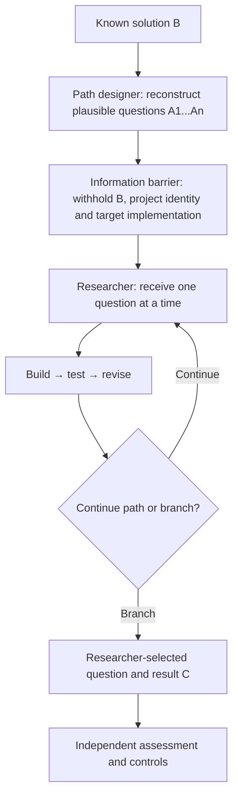
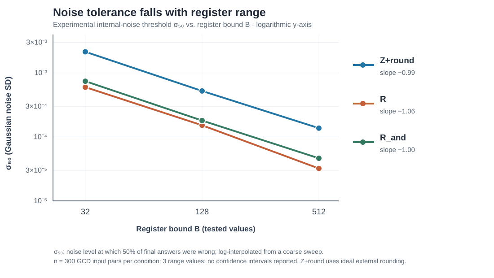

# Reverse Eureka Reconstruction (RER)

**Can a model discover something useful without being told what it is supposed to discover?**

*A research method for turning known solutions into question-led experiments.*

**Project author and research direction:** [taituo](https://github.com/taituo)  
**Status:** Open working paper and single-case experimental report (not peer-reviewed), 16 October 2026.

[**Read the research paper →**](paper.md) · [**Experimental results at a glance →**](#case-study-a-question-path-to-a-neural-cpu) · [**Figure: noise robustness →**](figures/noise_scaling.svg)

## The idea, in plain language

Imagine knowing the answer to an invention, but instead of giving that answer to a researcher, you write down the **questions someone might have asked on the way to discovering it**.

A second researcher gets only the questions, one at a time. They can explore, build software, test hypotheses and disagree with the implied direction. They are **not** told the original destination.

That is **Reverse Eureka Reconstruction (RER)**.

RER does **not** claim to reconstruct how the original inventor actually thought. It reconstructs a *plausible conceptual path*. The empirical question is whether that path is a useful seed for research—and whether it enables an unexpected branch rather than mere imitation.

### The procedure

The goal is **not** to force reproduction of B. Results can include reconstruction, a useful alternative, an unexpected technical finding, a falsified hypothesis, or failure.

## Case study: a question path to a neural CPU

In the first reported case, the known reference was [Cheng Lou's Handwired](https://github.com/chenglou/handwired), which explores compiling ordinary program logic into fixed-weight neural computation.

**Who did what**

| Role | Attribution |
|---|---|
| Method concept, research direction and case coordination | **taituo** |
| Generation of the planned 20-question reverse-reconstructed path | **Grok 4.7 Heavy** |
| Main implementation and experiments, with xhigh reasoning and no web access | **Opus 5.5** |
| Separate critical observer / reviewer | **Opus 5.5** |
| Ongoing methodological observer / reviewer | **GPT-6 Sol** |

The main research model was not explicitly given the target invention during the guided phase; **absence of web access does not imply absence of relevant knowledge from model training**. This is a single exploratory case, not evidence of independent rediscovery or confirmed scientific novelty.

Around question **11 of 20**, the Opus 5.5 research session had already produced a fixed-weight, stored-program ReLU CPU, tested against a reference interpreter. The scripted path was not finished. The subsequent open research phase investigated a weakness the model had encountered: **numerical instability**.

### What the research log reports

| Result | Reported measurement |
|---|---|
| Initial implementation | **364 passing tests** across the original codebase |
| Original CPU **Z**, single disturbance of 10⁻¹² in every state component | **300/300** trajectories diverged; median first mismatch **15 steps** |
| Restoring-AND CPU **Z_and**, single disturbance at tested sizes | **0/300** mismatches in the GCD conditions tested |
| Other workloads, disturbance 10⁻⁹ | **Z: 325/325 failures** for MULTIPLY, **16/16** for FIBONACCI; **Z_and: 0** in each |
| Internal Gaussian noise, σ = 10⁻³ | Wrong final answers: **R 79.0%**, **R_and 68.7%**, **Z+round 13.7%** |

The apparently mixed story matters: restoring logic gates prevented the measured **single-perturbation exponential blow-up**, but **did not eliminate internal-noise sensitivity**. The report then found a strong dependence on the permitted numerical range, associated with large-gain selection gates.

*Figure 1. Reported 50%-wrong-answer internal-noise thresholds versus register bound B. Values are interpolated from tested noise levels; lines are visual guides, not additional observations. See [methods, results and limitations](paper.md#results).*

## What this demonstrates—and what it does not

**Observed in this case:** the model went from guided questions to a working artifact, a self-selected research problem, preregistered predictions, disconfirming results, an architectural modification and new unresolved questions.

**Not yet demonstrated:** that RER is better than a conventional open-ended research prompt, that the model had no prior exposure to the underlying idea, that any technical result is novel, or that reported code/results have been independently reproduced.

The experiment was conducted by one primary research model. The two observer roles were **methodological review**, **not independent execution of the experiments**.

## Next experiments

1. **Budget-matched cold-start control:** same researcher, tools, turn count, and compute budget, but general “continue researching” prompts rather than RER questions.
2. **False-destination control:** reconstruct a plausible path toward a mathematically impossible target and measure whether the researcher detects the contradiction or produces a misleading success claim.
3. **Multiple starting solutions:** generate paths from open-source algorithms and legally analyzable compiled programs; study how reconstruction quality changes downstream research.
4. **Technical follow-up, separate from RER validation:** frozen exact computation inside a trainable network, and bit-encoded alternatives to large-gain scalar registers.

The full proposal, dataset provenance, detailed tables, threat analysis, references and suggested replication protocol appear in **[paper.md](paper.md)**.

## Reproducibility status

This repository initially publishes the **research description and transcribed measurements**. The results were taken from the primary research model's dated `research_log.md`. Raw experiment JSON files and executable source have **not yet been deposited here**, so the results should be treated as **research-agent-reported evidence awaiting independent verification**. The original 214-line preregistration is reported in that log as hash-protected; a historical timestamped snapshot has not independently been audited.

## Citation

If referring to this work, cite the project as an **unreviewed working paper**, not as a peer-reviewed publication:

> taituo (2026). *Reverse Eureka Reconstruction: Can Reconstructed Discovery Paths Seed Autonomous Research? A Single-Case Study.* GitHub working paper. https://github.com/taituo/rer

## Related work

This project builds on the distinction between known-solution reconstruction and open-ended search. Relevant precedents include [Handwired](https://github.com/chenglou/handwired), [Tracr](https://arxiv.org/abs/2301.05062), [Tree of Thoughts](https://arxiv.org/abs/2305.10601), [von Neumann's reliable computation](https://www.jstor.org/stable/j.ctt1bgzb3s.5), and [Maass & Orponen on analog noise](https://doi.org/10.1162/089976698300017359). A full discussion and bibliographic entries are in the paper.

---

**Central hypothesis:** a reconstructed *sequence of questions* may provide a different—and potentially useful—research prior from a direct description of the task. Whether that improves research quality is an empirical question, not an established result.
