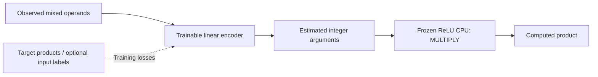

# Reverse Eureka Reconstruction (RER): Can Reconstructed Discovery Paths Seed Autonomous Research?

**A methodological proposal and an exploratory case study of fixed-weight ReLU computation**

**taituo**  
*Independent research project · Working paper · 16 October 2026*  
**Status:** Public, unreviewed research report. This document does not claim a peer-reviewed result or establish priority for any technical discovery.

> **Plain-language summary.** Most people ask AI to implement a specified goal. RER instead starts from something already invented, guesses the *questions that might have led to it*, and gives another AI only those questions—without revealing the destination. In our first case, this led to a functioning neural CPU and then to self-directed experiments on its numerical weaknesses. The technical results are interesting; whether RER caused better research than a normal open-ended prompt remains untested.

## Abstract

**Background.** Autonomous language-model researchers are typically assigned explicit objectives, example solutions, or evaluation functions. We propose **Reverse Eureka Reconstruction (RER)**: take a known solution **B**, construct a plausible retrospective sequence of conceptual questions **A₁ … Aₙ**, and deliver them sequentially to a second research model while withholding B. The objective is to seed inquiry without prescribing its final product. Historical authenticity of the reconstructed path is neither required nor claimed.

**Case.** A question designer (Grok 4.7 Heavy) constructed a planned 20-question path using Cheng Lou's *Handwired* as the reference. A separate researcher (Opus 5.5, xhigh reasoning, without web access) received guiding questions sequentially. Around the eleventh question it had implemented a stored-program CPU in fixed-weight ReLU computation. The guided sequence was stopped; the researcher was then asked to choose and rigorously test an unresolved question. It selected numerical robustness.

**Results.** In the researcher's own log, the original zero-margin CPU failed a full-state decoding test on 300/300 GCD trajectories after a one-time 10⁻¹² state perturbation (median first mismatch: 15 steps). Two-ReLU restoring AND gates removed those mismatches in specified one-time-noise tests (0/300), with similarly favorable findings for multiplication (325 cases) and Fibonacci (16 cases). Nonetheless, under *internal* Gaussian activation noise, substantial error rates remained, and the estimated 50%-wrong-answer threshold scaled approximately inversely with register bound. Several preregistered predictions were contradicted or materially revised.

**Follow-up.** In a subsequent, explicitly directed hybrid-network experiment, Opus 5.5 evaluated whether a learned linear encoder could use a frozen exact CPU. Direct supervision of its input interface succeeded in 5/5 random seeds on far-out-of-range tests, whereas unsupervised product-label methods exhibited substantial interface and extrapolation failures. This was a separate exploratory experiment, not another blind RER test.

**Interpretation.** This case documents **research branching and hypothesis revision** after a reconstructed question path. It does **not** yet show that RER outperforms an equally resourced open-ended research agent, that the finding is scientifically novel, or that training-data exposure to the source idea was absent. We present a controlled evaluation protocol to test those questions.

**Keywords:** autonomous research; curriculum design; reverse discovery; scientific methodology; code-to-neural compilation; numerical robustness; falsification; AI evaluation.

---

## 1. Motivation

A conventional instruction names a desired artifact: *“build a device driver,” “reproduce this paper,”* or *“optimize this algorithm.”* Such instructions supply a destination. They can make the model search for a familiar template or mimic an existing implementation. In contrast, an inventor usually traverses an uncertain sequence of intermediate questions, false starts, abstractions and tests before recognizing what should be built.

RER asks whether an *artificially reconstructed* version of that intellectual trajectory can serve as a productive research seed. The path is produced **backward**, knowing a later outcome, but consumed **forward**, without revealing that outcome. The researcher's deviations from the intended solution are not necessarily mistakes: they are potential new hypotheses, alternative designs or informative failures.

This differs from ordinary reverse engineering. Reverse engineering tries to infer how an artifact works. RER turns such an inference into a **sequence of questions for a different agent**. It also differs from Tree of Thoughts [4], which explores alternatives within a specified problem. RER tries to change the **initial framing of the research problem** itself.

The idea is compatible with automated experiments: select an existing algorithm or legally analyzable executable, infer a core mechanism, generate several alternative question sequences, run information-separated researchers, and compare their verified outputs. That larger pipeline is proposed here; it has **not** yet been demonstrated experimentally.

## 2. Formal proposal

Let **B** denote an existing solution and **P(B)** an inferred description of its useful mechanism. A path designer generates an ordered set

```text
A(B) = (q1, q2, ..., qn)
```

where each `qi` is a question intended to scaffold conceptual understanding. The researcher receives questions sequentially, performs work between questions, and may eventually be released into open-ended research:

```text
B → reconstruct A1...An → [withhold B] → researcher R(A1...Ak) → outcome C
```

Here **C** is not necessarily B, and **k** may be smaller than **n**. It may be a reimplementation, an independent alternative, a falsification, a research question or no useful result. The designer's knowledge of B means **information leakage is possible even without mentioning B by name**; language models also share background knowledge through their training data. Therefore “blind” refers only to the experiment's direct information barrier, **not** to a verified absence of prior model knowledge.

### 2.1 Proposed mechanism and testable prediction

A question sequence may supply an incremental representation of an unfamiliar domain while leaving the final objective open. This could improve exploratory productivity, or it could cause **destination bias** by nudging a researcher toward the known solution. Both possibilities are compatible with this proposal.

The primary, currently **untested** RER hypothesis is:

> At a matched model, tool set, interaction count and compute budget, a solution-derived question path can increase the rate of independently validated research outcomes relative to content-neutral research continuation prompts.

A competing hypothesis is that equivalent progress would arise from the same capable model with the same time and tools, regardless of the path.

### 2.2 Workflow


A responsible implementation requires role separation, the original path and instructions, an immutable results record, matched counterfactuals, and evaluation by *behavior* (code correctness, independent tests), not fluency alone.

## 3. Case-study design and provenance

### 3.1 Participants and attribution

| Contribution | Participant | Role and boundary |
|---|---|---|
| Method idea, overall design, experiment selection and coordination | **taituo** | Human project author |
| Reconstruction of a planned 20-question sequence from the known example | **Grok 4.7 Heavy** | Question-path designer; knew the destination |
| Architecture design, coding, hypotheses, experiments and final technical research log | **Opus 5.5** | Primary researcher; **xhigh** reasoning setting; **no web access** during the primary run |
| Independent critical reading and methodological discussion | **Opus 5.5** | Separate observer; did not independently rerun the reported experiments |
| Ongoing methodological assessment and paper development | **GPT-6 Sol** | Observer/reviewer; did not independently rerun the reported experiments |

The two observers are **not independent replication laboratories**. Their agreement with the researcher would not by itself validate technical results. No model was credited with historical reconstruction of Cheng Lou's actual thought process.

### 3.2 Reference and guided phase

The known reference was [Handwired](https://github.com/chenglou/handwired), a project exploring the conversion of ordinary programs into neural computation with explicitly constructed weights [1]. This was chosen as an intellectual starting point, **not** used as a verified benchmark for the researcher's later robustness claims.

The planned RER path comprised 20 questions; the research session diverted around question 11, rather than completing it. The earliest visible foundational question was:

> What is a neural network made of at the lowest level?

A later question addressed state:

> Can I represent program state (variables that change) as values flowing through these matrix operations?

Those quotations illustrate the progression from primitive computations toward executable state machines. The exact count of all human turns versus substantive questions should be verified against the complete original transcript before any formal causal analysis.

The primary researcher was not explicitly given the target's name or source. It nonetheless had potential access to related ideas via model pretraining, a serious limitation of any independence claim.

### 3.3 Emergence of an experimental branch

By the branching point, the researcher reported fixed-weight constructions for Boolean/comparison logic, compiled conditional programs and a stored-program CPU. The CPU had a fixed ReLU transition network that iterates over a numerical state containing the program, control state and registers. The initial implementation's report listed **364 passing tests**, including differential comparisons with a Python interpreter. These numbers are **self-reported and not independently reproduced for this publication**.

The research session then received an open request to choose an important missing question, compare directions, record predictions before testing, and investigate one uncertainty with controls and counterexamples. It chose **dynamical stability under noise**, partly motivated by an earlier interrupted experiment that produced overflow warnings when weights were perturbed.

This is the **candidate branch C** of the RER methodology. The result was not an unrelated invention or a demonstrated novel concept; it was a substantive technical extension of an implementation developed during the guided phase.

## 4. Why the technical question matters

For integer-valued difference `d`, a threshold can be represented by

```text
GT0(d) = ReLU(d) − ReLU(d − 1)
```

which equals 0 for integers `d ≤ 0` and 1 for integers `d ≥ 1`. A Boolean AND gate on bits `p,q ∈ {0,1}` is

```text
AND₀(p,q) = ReLU(p + q − 1).
```

These are exact **at the intended discrete levels**. Yet the piecewise-linear extensions between and beyond those levels are not generally stable under perturbation. For example, when both active inputs are `1 + δ`,

```text
AND₀(1+δ, 1+δ) = 1 + 2δ           (for sufficiently small δ).
```

Thus, a small correlated input error can double. Repeating a fixed-weight CPU step turns this into a dynamical-systems problem. **Exact integer execution and robustness to non-integer perturbations are distinct properties.**

The researcher compared:

| Label | Mechanism |
|---|---|
| **Z** | Original zero-margin fixed-weight ReLU CPU |
| **Z+round** | Z with ideal **external** rounding/clipping at step boundaries; an upper-bound reference, not a fully in-network equivalent |
| **R** | Z preceded by a ReLU-based state restoration network |
| **Z_and** | Z with the simple Boolean AND gates replaced by margin-restoring versions |
| **R_and** | R plus margin-restoring AND gates |

For a binary field, R can use a saturating restoration function:

```text
restore(x) = 2·ReLU(x − 0.25) − 2·ReLU(x − 0.75).
```

A simple restoring AND gate similarly uses two ReLUs, with a flat region at valid logical sums:

```text
AND_m(p,q) = 2·[ReLU(p+q−1.25) − ReLU(p+q−1.75)].
```

The exact tolerated perturbation per input depends on the **sum** of input perturbations; a quoted margin in the sum must not be mistaken for an identical independent margin on each wire. The gate formula returns the exact Boolean truth table on valid inputs.

Related principles of restoring logic and computation with unreliable elements long predate this case [2,3]. The question here is the *behavior of the particular implemented ReLU CPU and the cost of restoring its operation*, not a claim to invent noise margins.

## 5. Experimental methods

The researcher's dated `research_log.md` divides its work into an original preregistration, pre-run clarifications, post-observation exploratory predictions, and a final report. The original predictions must be distinguished from later exploratory probes.

- **Workload:** subtraction-based greatest common divisor (GCD) on a fixed random selection of 300 ordered input pairs from `[1,30]²`, seed 0.
- **Reference:** clean execution against a reference interpreter and known integer registers/PC.
- **Main CPU:** eight instruction slots, four registers, register bound **B = 32**, constant bound 1.
- **Experiment A:** a single Gaussian-direction perturbation of amplitude ε in selected initial-state components; 300 steps.
- **Experiment B:** independent Gaussian noise with SD σ after every state transition; 500 steps.
- **Experiment C:** independent Gaussian noise in hidden activations after ReLU, inside each transition; 500 steps.
- **Exploratory probes:** directional-derivative propagation at ReLU kinks, layer-specific noise, alternate gate designs, alternative workloads, and range-scaling tests.

**Measurement distinction.** The *first decoded-state mismatch* is a strict measure: it counts an error even in a program field not used during execution. The *correct final answer* is weaker in a different sense: an incorrect intermediate state may recover, or an erroneous run may accidentally produce the correct output. We report these separately rather than conflating them.

For the range-scaling comparison, `σ50` is the noise SD at which 50% of final answers are wrong, **interpolated on a coarse tested noise grid**. It is not an exact physical threshold.

### 5.1 Data provenance

All numerical results below are **transcribed from the primary researcher's final 661-line report** supplied for this working paper. The report identifies `noise_results.json`, `probe_results.json`, `probe_results_T5.json`, `probe2_results.json`, `probe3_results.json`, `t5.log`, and `p89.log` as its underlying artifacts. These raw data and executable scripts **are not included in this initial repository release**. We therefore treat the numerical findings as *reported experimental evidence pending independent reproduction*, not as independently audited measurements.

The report says its initial preregistration (lines 1–214) was hash-protected and preserved before experiments. **The original chronological snapshot has not been independently verified** here. Post-A/B/C predictions are **exploratory addenda**, not original preregistered tests.

## 6. Results

### 6.1 A: a one-time disturbance destabilized Z

**Table 1.** Median step of the first full-state decoding mismatch for Z, with eight slots and B = 32. The report recorded **300/300 runs failing** within the horizon in every displayed condition.

| Perturbed components | ε = 10⁻¹² | ε = 10⁻⁹ | ε = 10⁻⁶ | ε = 10⁻³ |
|---|---:|---:|---:|---:|
| Entire state | 15 | 11 | 7 | 3 |
| Active program-counter bit | 32 | 21 | 13 | 5 |
| Registers only | 55 | 45 | 35 | 24 |
| Program fields | 15 | 11 | 7 | 3 |

This supports rapid instability of **this implementation**, not the claim that every possible hand-constructed ReLU algorithm is unstable. The report also documents an exception in a different configuration: for B = 4096, register-only perturbations at 10⁻¹² produced failures in 74%, not 100%, of runs within 300 steps. The researcher suspected float64 absorption near numerical resolution; this explanation was **not independently tested**.

The initial fitted growth estimates were about 5–7 for all-state/program disturbances but about 2 for active-PC disturbances. Follow-up directional-derivative experiments resolved much of the apparent discrepancy: the *early* 0–12 step window yielded gains near 6.8 (all), while the *late* 30–120 window yielded **2.00** across tracked locations. The originally registered scalar growth estimate mixed these phases. Reporting the early fit as a universal per-step growth constant would be misleading.

A separate halted-state probe perturbed the presumed HALT fixed point by 10⁻¹²: **300/300** trajectories suffered a decoded-state mismatch, at median **23 steps** (maximum 41). This corrected an earlier implementation-level assertion that additional steps after HALT were harmless outside ideal arithmetic.

### 6.2 B and C: state noise and internal noise are different problems

**Table 2.** Selected fractions of runs with a *first readout error* during 500 steps under **state noise** (Experiment B). A zero is the observed sample count, not a guarantee of indefinite reliability.

| State-noise SD σ | Z | Z+round | R |
|---|---:|---:|---:|
| 10⁻⁶ | 100% | 0% | 0% |
| 0.03 | 100% | 0% | 0% |
| 0.05 | 100% | 0% | 2.7% |
| 0.08 | 100% | 0% | 100% |
| 0.12 | 100% | 76.7% | 100% |

The researcher explicitly observed that certain readout-hazard predictions were close to **tautologies** under the chosen margin/readout definition; these were not counted as strong independent tests of a new scientific mechanism.

The semantic outcome differed markedly. At state-noise σ = 0.08, **100% of R runs** had a readout error at least once, yet **84.7% ended with a correct final answer** after clean settling. Errors in unused program fields or transient intermediate values need not invalidate the calculation.

**Table 3.** **Wrong final-answer rates**, not first mismatch rates, under **internal Gaussian activation noise** at σ = 10⁻³.

| Design | Wrong final answer |
|---|---:|
| R | **79.0%** |
| R_and | **68.7%** |
| Z+round | **13.7%** |

The internal restoration layer in R introduced its own source of noisy activation errors. Experiments isolated that layer as responsible for roughly **75.3% wrong answers** when it alone was perturbed at σ = 10⁻³, compared with about 9.7% for the vulnerable fetch layer of Z+round. The new AND gates improved some conditions but did not make R_and immune to **full internal noise**; a prediction of ≤10% wrong answers was contradicted by 68.7%.

### 6.3 Restoring logic removed the measured single-perturbation instability

The most successful architectural intervention was to replace zero-margin AND gates with the saturating two-ReLU version. The new CPU was first compared with an interpreter for **100 randomly generated programs × 30 steps**, reported as passing the lockstep checks.

For the GCD workload, **Z_and** had **0/300** first-state mismatches for each reported single-disturbance amplitude ε = 10⁻¹², 10⁻⁶ and 10⁻³ during 300 steps. The residual deviation was reported to remain bounded, about **6.4ε**.

Follow-up programs tested whether the finding was specific to GCD. Under one-time ε = 10⁻⁹ perturbations:

| Program | Cases | Original Z: first mismatch | Z_and: first mismatch |
|---|---:|---:|---:|
| MULTIPLY | 325 | 325/325 | **0/325** |
| FIBONACCI | 16 | 16/16 | **0/16** |

This is meaningful evidence that the proposed gate change helps across **multiple tested programs**, not a proof of unlimited-time stability across every program.

For persistent state noise, Z_and still suffered **2/300** readout errors at σ = 10⁻³ and **100%** at σ = 10⁻². Therefore *absence of exponential blow-up after a single disturbance* should not be equated with *reliable operation under continuous stochastic noise*.

### 6.4 A further quantitative limitation: dependence on register range


**Figure 1.** Estimated 50%-wrong-final-answer activation-noise level `σ50` vs. permitted register bound B (logarithmic scale). Lines connect only the three tested B values; the data are agent-reported and uncertainty intervals were not computed.

**Table 4.** Values reported for 300 GCD input pairs per condition, interpolated from a half-decade noise sweep.

| Design | B=32 | B=128 | B=512 | Log–log slope |
|---|---:|---:|---:|---:|
| Z+round | 2.14×10⁻³ | 5.22×10⁻⁴ | 1.37×10⁻⁴ | −0.99 |
| R | 5.99×10⁻⁴ | 1.52×10⁻⁴ | 3.21×10⁻⁵ | −1.06 |
| R_and | 7.42×10⁻⁴ | 1.80×10⁻⁴ | 4.63×10⁻⁵ | −1.00 |

For these points the empirical relationship is approximately

```text
σ50(B) ∝ 1 / B.
```

The model's interpretation is that control-bit errors propagate through **large-gain (big-M) operand-selection gates**, so increasing the permitted magnitude of register values reduces tolerable internal noise. This inference is consistent with other reported probes, but **three register sizes, interpolation and missing confidence intervals do not establish a universal scaling law**.

The most important proposed next technical test is whether **bit-encoded registers with restoring logic** can avoid this range dependence. That proposal is **untested**.

### 6.5 Original predictions versus outcomes

A scientifically relevant feature of the case is that the researcher did not report only supportive results.

| Early prediction or expectation | What the recorded work found | Assessment |
|---|---|---|
| Growth near 1.3–2.1 | Early all/program fit 4–7; later tangent regime ≈2 | **Mixed; initial estimate inadequate** |
| Failure-time slope 3–8 steps per decade | About 1.3 for all/program; ≈2.7–3.7 for PC/registers | **Partly contradicted** |
| R and Z+round comparably robust internally | Z+round substantially better | **Contradicted** |
| A restoring AND preserves correct program execution | Random-program interpreter lockstep passed | **Supported in tested programs** |
| R_and full internal-noise wrong rate ≤10% at σ=10⁻³ | 68.7% | **Contradicted** |
| Internal-noise threshold approximately inversely proportional to B | Slopes ≈−1 for three designs | **Consistent over three sampled bounds** |

Some statements were registered **after** earlier results and should be read as exploratory follow-up predictions, not as equally independent confirmation.

## 7. What can be inferred about RER itself?

The available evidence supports the following **descriptive sequence**:

1. A known technical idea was converted into an ordered path of questions.
2. An information-separated research model developed executable mechanisms along that path.
3. Before the scripted path finished, the model had developed a CPU not explicitly requested in the visible state question.
4. In an open continuation, the model selected its own unresolved technical issue.
5. It formed predictions, implemented experiments, faced contradicting results, revised its mechanism, and measured a corrective intervention.
6. Its final report acknowledged both successful and failed predictions and identified an unanswered scaling issue.

This is a **single-case demonstration of research-like branching**. The sequence alone cannot establish the causal effect of RER questions. A capable model exposed to the same initial topic and equivalent resources might have constructed the CPU and run similarly productive tests.

Nor does the technical branch prove scientific novelty. The key ideas of noise margins, restoring logic and robust computation are established [2,3]. The research agent's lack of web access prevented it from verifying prior literature, and this paper makes no claim that these particular constructions are unprecedented.

### 7.1 Threats to validity

- **n = 1 primary session.** No performance distribution over seeds, models or prompts.
- **No matched control.** Question-path benefits cannot yet be separated from model capability, conversation duration or compute budget.
- **Training-data contamination.** Withholding the named destination does not eliminate pretraining exposure to the source idea or its relatives.
- **Question leakage.** Selecting questions retrospectively with B known embeds information about B, even without naming it.
- **Provenance gaps.** Full prompt-by-prompt transcript, original question set, exact model/token cost records, primary executable files and raw JSON are not yet deposited in this repository.
- **Agent-generated measurements.** The reported numbers and instrumentation were generated and assessed in the same main research session.
- **Post-hoc search.** Later experiments chose which mechanism to probe after seeing earlier results. This is legitimate exploration, but not independent preregistered confirmation.
- **Limited numerical environment.** Floating-point and Gaussian-noise experiments on the described CPU are not interchangeable with real accelerators or every conceivable neural-circuit compiler.
- **Multiple dependent measures.** Full-state mismatch, wrong final answer, noise hazard, tangent growth and estimated σ50 answer different questions. They must not be pooled into a single “success” score.
- **Small samples at failure boundaries.** 0/300 events suggests an approximate 95% upper binomial risk bound of 1% only under suitable independence assumptions; it does not imply zero true risk.

### 7.2 Exploratory follow-up: can a trained network learn to use a frozen exact CPU?

**This is a separately prompted continuation, not part of the original blinded RER path or a preregistered comparison of RER to an alternative method.** After the noise study, the researcher was asked to investigate the combination of frozen exact weights and trainable weights. The researcher designed and reported a six-arm experiment, writing its hypotheses and predictions before the runs according to its log. The reported primary continuation comprises **five random seeds per training method** and **383 passing code tests** by the end of this phase. The additional code and numerical JSON are not yet available in this publication for independent verification.

**Question.** If a ReLU CPU performs multiplication exactly on integers, can a trainable encoder learn the CPU's input arguments from examples of correct products only? A learned **linear encoder** received a random linear mixture of operands `(a,b)`, where `a` is the data value and `b` determines the loop count in the fixed CPU's repeated-addition multiplication program. The researcher compared optimization through the module with black-box finite differences, direct interface supervision, and a module-free multilayer perceptron. Evaluation included values well beyond the training range, reportedly as large as `a=500` and `b=100`.



**Table 5.** Main outcomes reported for the hybrid experiment. “Train successes” counts runs that met the researcher's success criterion, not all runs with partially useful predictions. “Far OOD” describes accuracy substantially beyond the training range.

| Training arm | Training outcome (five seeds) | Far-out-of-range behavior | Interpretation |
|---|---|---|---|
| **BP-Z_and**: backpropagation through margin-restoring CPU | **0/5 succeeded** | Not established as successful | Loop-count gradient zero; the corresponding encoder coefficients did not learn |
| **BP-Z**: backpropagation through zero-margin CPU | **0/5 succeeded** | Not established as successful | Large, constant-sign control derivative did not yield convergence |
| **FD**: black-box finite differences on neighboring integer arguments | **2/5 succeeded** | **0% correct** in far-range checks for the reported successful training seeds | Black-box objective could fit training products without learning a precise interface |
| **FD+snap**: finite differences plus a pull-toward-integers loss | **3/5 succeeded** | **0% correct** for the reported far-range checks | Rounding encouragement improved training fits, not robust extrapolation |
| **Extended self-rounding**: longer schedule (exploratory) | **2/5 reached nearly exact interfaces** | Those two seeds reached **100%** far accuracy | Strong extrapolation was possible but not reliable |
| **IF-sup**: supervise the true module input arguments | **5/5 succeeded** | **100%** correct far away | A sufficiently accurate input interface transferred the CPU's exact calculation |
| **MLP**: ordinary network, no compiled module | Did not achieve strong train performance (reported ≈53%) | **0%** far accuracy | A reference baseline, but not a successful train-range comparator |

The extended schedule is an **additional exploratory condition**, not one of the initial six distinct methods; furthermore, extending training and altering the loss schedule were confounded in the reported continuation. The two successful extended runs do not imply the technique reliably solves the problem. Correct final answers and exact learned argument recovery are different metrics.

**Gradient observations.** The multiplication program separates two roles. Its data operand `a` has a useful local derivative `∂(a·b)/∂a = b` at intended positive-integer operating points. In contrast, `b` is a **control-flow input** determining how often the CPU loops. The researcher reports **zero** gradient in the restoring-margin implementation for `b`; the zero-margin implementation instead produced a large **constant-magnitude, sign-valued gradient (±240,000 in this setting)**. Neither trained the control-input mapping in five seeds. Boundary kinks, including a `ReLU'(0)=0` convention, limit sweeping “everywhere” claims; these are local, implementation-specific autodifferentiation observations rather than a general theorem about all fixed-program modules.

**Interface precision and extrapolation.** Some trained encoders reached correct answers after integer rounding while retaining continuous coefficient errors of order **0.5** on training inputs. A linear encoder's residual can scale approximately with input magnitude, so at far larger inputs the residual can cross the rounding boundary and produce wrong arguments. In the report, far-range encoder error grew to roughly **11–32** in representative runs, despite training-set products being correct. With direct input supervision, learned interfaces approached numerical precision and all five seeds extrapolated correctly. This indicates a useful **system-level limitation**: a perfectly correct component does not guarantee a correct composite system when its learned interface is only approximately correct.

**Contradictory predictions.** The researcher expected the very large sign-correct BP-Z gradient to be sufficient for at least some successful training; **0/5** trials met that expectation. It predicted at least four successes for FD and FD+snap but observed **2/5** and **3/5**, respectively. It predicted at least four successful long-schedule snap runs and observed **2/5**. It also initially expected nonsense from non-integer loop counters in Z, whereas its limited direct tests suggested a consistent **floor-like rule**, `a·floor(b+δ)`, rather than arbitrary corruption. The log's brief summary also used conflicting rounding-up wording; the **mechanism remains incompletely explained**, so this paper reports the narrower empirical observation without adopting a proven global floor-function claim.

**Limits of interpretation.** The design comprises **one synthetic multiplication program, a linear encoder, five seeds and a selected out-of-distribution range**. It is not an experiment on an actual language model, general tool use, or Handwired's source implementation. The data do **not** show that gradient-based training through frozen modules is generally impossible. They show that **control-input gradient and learned-argument precision were bottlenecks in this specific setup**; a direct supervised interface succeeded. The report contains several hypotheses contradicted by evidence and at least one unresolved optimization plateau. These negative results are part of the finding.

### 7.3 Relation to prior research and novelty boundaries

This case is best positioned relative to **established mechanisms**, rather than presented as a first discovery of symbolic neural computation or training around discrete decisions:

- **Neural Arithmetic Logic Units (NALU)** [9] explicitly aim at arithmetic generalization outside the training range. They are an important comparator to a fixed exact arithmetic module and an ordinary MLP, although the architectures and objectives differ.
- **TerpreT** [10] investigates program induction and differentiable-interpreter formulations, including gradient-based and discrete search back ends. It makes clear that hard program/control decisions and optimizer choice were studied well before this case.
- **Differentiable Forth / ∂4** [11] integrates trainable program components into differentiable execution. It is highly relevant to hybrid fixed/trainable computation, but not an evaluation of this particular ReLU CPU.
- **Straight-through gradient estimators** [12] are an established technique for replacing the unusable derivative of discrete operations with a surrogate. **No dedicated straight-through-versus-soft-ramp controlled arm is documented in the available hybrid result**. Their potential utility here is a follow-up hypothesis, not a finding.
- **Toolformer** [13] learns *when and how* to issue tool calls, including argument strings, rather than differentiating through a tool's internal calculation. It is a meaningful conceptual comparison to supervised module interfaces, **not evidence that the present toy CPU experiment predicts real language-model behavior**.

The specific numerical behavior of this particular fixed-ReLU architecture may warrant further comparison with prior implementations, but the evidence currently supports only **architecture- and task-specific observations**. Systematic literature review and independent reproduction are prerequisites to any claim of novelty.


## 8. A controlled research program

We propose a prospective evaluation designed specifically to measure RER rather than impressiveness of an individual autonomous agent.

### 8.1 Budget-matched cold-start comparison

For each target solution B, create several paths using the same question-designer model. Randomly allocate separate research-model runs to:

**RER arm:** foundational, ordered questions derived from B, delivered one at a time.

**Active control:** same starting domain and same number of research turns, but content-neutral follow-ups such as “Continue. What is the most important next question? Investigate it.”

Hold constant the research-model version, thinking setting, tools, availability of external sources, starting workspace, interaction count, wall/compute ceilings, and evaluation suite. Record both **tokens/credits** and actual tool-compute time. The original case's exact transcript must be used to audit whether 11 substantive questions correspond to the matched number of turns.

Both arms then receive an identical open-ended research prompt. The primary endpoint should be selected in advance: for example, **the proportion of runs that yield at least one independently verified, nontrivial technical result within budget**. Secondary endpoints include correctness, cost per result, justified negative findings, and useful divergence from B.

Multiple targets and multiple runs per arm are essential before making population-level claims. One matched pair would be illustrative, not a reliable causal estimate.

### 8.2 Blind artifact evaluation

Strip treatment labels and author/model identifications from code, experiment reports and claims. Use independent hidden tests and a structured rubric (for example, correctness, falsifiability, reproducibility, documented failure analysis and resource use). External reviewers should not know whether a result came from RER or control. Frameworks such as PaperBench [6] show the importance of separately specifying what counts as successful replication and validating the evaluator.

### 8.3 Impossible-destination negative control

Choose an attractive but mathematically impossible B, such as the proposition that a **finite ReLU network computes a discontinuous Heaviside step exactly for every real number**. A finite composition of continuous affine and ReLU operations is continuous, so the claimed exact real-domain step cannot exist. It *can* be matched on a discrete integer set, making a restricted demonstration an instructive failure mode.

A designer who knows this false destination writes a plausible discovery path. An isolated researcher receives only the questions. Scoring distinguishes: detecting the impossibility, identifying a valid restriction, deriving a different useful result, or making an unfounded “breakthrough” claim.

This tests **destination leakage and susceptibility to confirmation bias**. A model that correctly refuses the false conclusion would provide positive evidence of scientific resilience; a seemingly successful implementation could reveal misleading evaluation rather than discovery.

### 8.4 Scaling RER to executable artifacts

One potential pipeline begins from **an open-source project or its lawfully inspectable compiled binary**, reconstructs only the core functional mechanism using behavior tests and reverse engineering, then generates question paths from that inferred mechanism. Study the effect of information quality: behavior-only observations vs. partial mechanism reconstruction vs. near-complete reconstruction. A second model receives questions but not the original artifact or target identity.

The important distinction is **not “optimize this existing program.”** It is **“use knowledge of an existing implementation to synthesize a possible discovery trajectory, then test what a separate researcher constructs.”**

Optimization and equivalence testing may become meaningful *after* an alternative artifact exists; performance or novelty must not be inferred merely from structural differences.

## 9. Conclusion

RER is a procedure for **converting a known solution into an ordered, partially information-separated research curriculum**. The first case yielded a concrete technical branch: a compiled ReLU CPU, measured fragility in its zero-margin transition logic, experiments with restoring gates, contradictory predictions, and an unresolved internal-noise/range trade-off.

These observations justify **investigating** RER, not declaring it superior or novel. The subsequent directed hybrid experiment adds a concrete negative/positive comparison on training interfaces, without proving end-to-end learnability for real language models. The next decisive work is not another elaborate case story; it is a budget-matched, multi-run, blindly assessed control study. The impossible-destination experiment provides an especially important safeguard against mistaking an elegant question path for evidence of truth.

The long-term ambition is an automated system that converts existing implementations into research opportunities without prescribing which outcome should be discovered. Its value must be determined empirically by valid results and informative failures.

---

## Author contributions, model disclosure and acknowledgments

- **taituo:** originator of the RER method proposal; research framing, guiding question delivery, decisions on branching and evaluation, and public project coordination.
- **Grok 4.7 Heavy:** generated the planned reverse-reconstructed 20-question path using the known source idea.
- **Opus 5.5 (primary researcher):** generated the tested ReLU-CPU implementation, designed and executed reported numerical experiments, recorded and interpreted hypotheses, and wrote its final technical log. The primary research session operated with **xhigh reasoning and no web access**.
- **Opus 5.5 (separate observer):** critical methodological evaluation and follow-up recommendations.
- **GPT-6 Sol:** methodological observation, synthesis, and assistance organizing the case study.

The human project owner is identified by the GitHub account name **taituo**; no legal or institutional identity is inferred. The two observer-model roles should not be confused with replication or external scientific peer review.

**Competing interests:** none disclosed in the supplied materials.  
**Funding:** not specified.  
**Ethics / disclosure:** this is an AI-agent methods case study; no human subjects or personal data are analyzed in the reported technical experiments.  
**Code/data availability:** project description, figure and working paper are public in this repository. The underlying experiment source and JSON logs, including the later hybrid-network experiment artifacts, are **not part of this release**. The recorded summary should be treated as a research-agent self-report until these are archived and rerun.

## References

1. Lou, C. *Handwired: Turn your regular JavaScript code into a neural net.* Open-source project. https://github.com/chenglou/handwired (accessed October 2026).
2. von Neumann, J. (1956). *Probabilistic logics and the synthesis of reliable organisms from unreliable components.* In *Automata Studies*, pp. 43–98. https://www.jstor.org/stable/j.ctt1bgzb3s.5
3. Maass, W., & Orponen, P. (1998). *On the effect of analog noise in discrete-time analog computations.* Neural Computation, 10(5), 1071–1095. https://doi.org/10.1162/089976698300017359
4. Yao, S., et al. (2023). *Tree of Thoughts: Deliberate Problem Solving with Large Language Models.* NeurIPS 36. https://arxiv.org/abs/2305.10601
5. Lindner, D., et al. (2023). *Tracr: Compiled Transformers as a Laboratory for Interpretability.* NeurIPS 36. https://arxiv.org/abs/2301.05062
6. Starace, G., et al. (2025). *PaperBench: Evaluating AI's Ability to Replicate AI Research.* ICML / PMLR 267. https://proceedings.mlr.press/v267/starace25a.html
7. Zaremba, W., & Sutskever, I. (2014). *Learning to Execute.* arXiv:1410.4615. https://arxiv.org/abs/1410.4615
8. Karpathy, A. (2026). *autoresearch.* Open-source experiment framework. https://github.com/karpathy/autoresearch
9. Trask, A., Hill, F., Reed, S., Rae, J., Dyer, C., & Blunsom, P. (2018). *Neural Arithmetic Logic Units.* NeurIPS 31. https://papers.neurips.cc/paper_files/paper/2018/hash/0e64a7b00c83e3d22ce6b3acf2c582b6-Abstract.html
10. Gaunt, A. L., Brockschmidt, M., Singh, R., Kushman, N., Kohli, P., Taylor, J., & Tarlow, D. (2016). *TerpreT: A Probabilistic Programming Language for Program Induction.* NeurIPS. https://openreview.net/forum?id=Sk6W5JJke
11. Bošnjak, M., Rocktäschel, T., Naradowsky, J., & Riedel, S. (2017). *Programming with a Differentiable Forth Interpreter.* ICML 34. https://arxiv.org/abs/1605.06640
12. Bengio, Y., Léonard, N., & Courville, A. (2013). *Estimating or Propagating Gradients Through Stochastic Neurons for Conditional Computation.* arXiv:1308.3432. https://arxiv.org/abs/1308.3432
13. Schick, T., et al. (2023). *Toolformer: Language Models Can Teach Themselves to Use Tools.* NeurIPS 36. https://papers.neurips.cc/paper_files/paper/2023/hash/d842425e4bf79ba039352da0f658a906-Abstract-Conference.html

### Suggested citation

taituo (2026). **Reverse Eureka Reconstruction (RER): Can Reconstructed Discovery Paths Seed Autonomous Research?** Unreviewed working paper and single-case experimental report. https://github.com/taituo/rer/blob/main/paper.md


## Inspired by

- **[Cheng Lou — Handwired](https://github.com/chenglou/handwired):** the *technical starting point B* for the first RER question path: representing ordinary computation with explicitly constructed neural weights. Handwired is the reference idea, **not** the codebase whose numerical behavior was experimentally characterized here.
- **[Felix Rieseberg — *How to be more ambitious: A tutorial for humans with models* (13 October 2026)](https://felixrieseberg.com/how-to-be-more-ambitious-a-tutorial-for-humans-with-models/):** a broader inspiration for raising the abstraction level of AI work, getting closer to primary materials, crossing disciplinary boundaries, and testing outcomes with independent evidence. RER is a proposed **specific scientific workflow**, not an experimental result established by that essay.

These credits acknowledge conceptual inspiration; they do not imply endorsement, co-authorship, or that either source validates the RER hypothesis.
